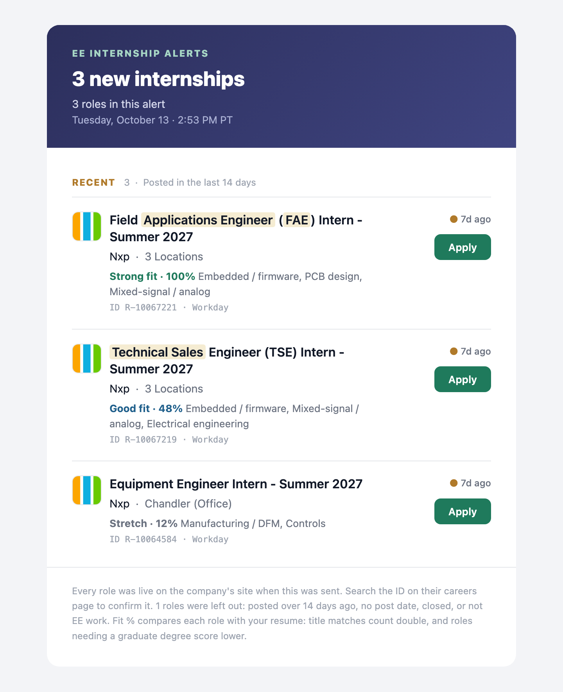
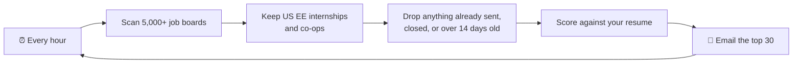

# ee-jobscanner ⚡

[](https://github.com/hshaoob/ee-jobscanner/actions/workflows/scan.yml)

**Stop refreshing career pages.** Every hour this checks 5,000+ company job boards for new electrical engineering internships and co-ops, scores each one against *your* resume, and emails you the best matches.

It's free, it runs on GitHub's servers, and nothing has to stay open on your computer.



<!-- Demo video goes here: record one hourly run and paste the link on this line. -->

## Does this solve my problem?

| If you're thinking... | Here's what it does |
|---|---|
| "I find out about roles a week late." | Scans every hour, so you can apply the day a role is posted. |
| "Half the listings I click are dead." | Re-checks every posting right before emailing. Closed, filled, or older than 14 days gets dropped. |
| "I can't tell which ones are worth my time." | Each role gets a fit score (Strong / Good / Stretch) and the skills it matched. |
| "Job sites bury me in junk." | Only US internships and co-ops that are actually EE work. Max 3 per company, 30 per email. |

**Not for you (yet) if** you aren't looking for EE internships. The filters are built for EE, so another major means editing the keywords in `jobscan.py`.

## Set it up (about 10 minutes, no coding)

You need a GitHub account and a Gmail account.

1. **Copy the project.** Click **Fork** at the top of this page, then **Create fork**.
2. **Add your resume.** 📄 This step is required for fit scores. Without it, every score is based on *my* resume, not yours.
   In your fork, open `jobscan.py`, click the pencil, and find the list named `PROFILE`. Replace the skills with the ones on your resume, then click **Commit changes**. Each line looks like this:
   ```python
   ("PCB design", r"\bpcb|schematic|kicad|altium", 2),
   #  label          words to look for          importance (1 to 3)
   ```
   List skills only. Your fork is public, so leave out your name, phone, and address.
3. **Get a Gmail app password.** Turn on [2-Step Verification](https://myaccount.google.com/security), then go to [App passwords](https://myaccount.google.com/apppasswords), name it `jobscan`, and copy the 16-letter code (remove the spaces).
4. **Add three secrets.** In your fork: **Settings → Secrets and variables → Actions → New repository secret**.

   | Name | Value |
   |---|---|
   | `JOBSCAN_FROM` | the Gmail address that sends the alerts |
   | `JOBSCAN_TO` | the address that gets the alerts |
   | `JOBSCAN_PASS` | the 16-letter code from step 3 |
5. **Turn it on.** Open the **Actions** tab, click the green button to enable workflows, then **scan → Run workflow**.

That's it. Your first email arrives within about 20 minutes, and it keeps running every hour without you.

## Common questions

- **No email showed up.** Actions → scan → **Run workflow** to restart it. `last_run.txt` says what went wrong.
- **A company is missing.** Add its careers link to `companies.txt`, one per line.
- **I want a break.** Actions → scan → **⋯ → Disable workflow**. Turn it back on the same way.
- **I want every open role on day one.** Delete `seen.json` in your fork. It remembers what has already been sent.
- **I'd like to try it on my computer first.** `python3 jobscan.py dry` runs a full scan and prints the matches without emailing anything.

## Can I use this code?

Yes. Fork it, change it, make it yours. If it helps you land something, I'd love to hear about it.

## Who made this?

I'm **Hamzah Shaoob** ([@hshaoob](https://github.com/hshaoob)), an electrical engineering student. I built this because I was tired of checking the same career pages every morning and still missing roles. Now I get an email instead.

## What I learned

- **Every job site is different.** Workday, Greenhouse, Lever, Oracle and a dozen others each needed their own scanner, and they change without warning.
- **"New to me" isn't "new."** Early on, months-old postings slipped through as "just posted." Now a role needs a real post date from the company or it isn't sent.
- **Don't trust the schedule.** GitHub's hourly timer skipped most hours, so each run now starts the next one itself.
- **Silence should mean broken.** Quiet hours still send a short "no new roles" email. If nothing arrives, I know something failed.
- **Filter early.** Global companies buried US roles under foreign ones until I asked each site for US roles only.

## Learn more

- [Watch it run live](https://github.com/hshaoob/ee-jobscanner/actions/workflows/scan.yml): every hourly scan, with logs
- [CHANGELOG.md](CHANGELOG.md): what changed and why
- [Open an issue](https://github.com/hshaoob/ee-jobscanner/issues) for questions, bugs, or a company you want added

<details>
<summary>How it works under the hood</summary>



Supported sites: Workday, Greenhouse, Lever, Ashby, SmartRecruiters, Oracle, iCIMS, SuccessFactors, Taleo, Eightfold, Phenom, Jibe, plus Apple, Google, Amazon and Microsoft. Everything lives in one file, `jobscan.py`. Run `python3 jobscan.py test` for a quick self-check.

</details>
